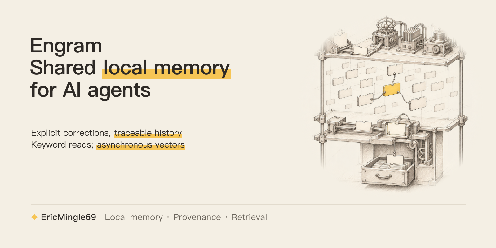

<picture>
  <source media="(prefers-color-scheme: dark)" srcset="readme-assets/cover-en-dark.png">
  
</picture>

<p align="center"><a href="docs/architecture.md">Architecture</a> · <a href="docs/research-directions.md">Research</a> · <a href="CHANGELOG.md">Changelog</a> · <a href="CONTRIBUTING.md">Contributing</a></p>
<p align="center">


</p>
<p align="center"><a href="README.md">简体中文</a> · <b>English</b></p>

# Engram · Shared local knowledge for agents

Engram 0.4.1 keeps long-term knowledge in a local SQLite database shared by different agents. Writers provide content; classification and vectors are completed later. Explicit corrections preserve provenance while reads distinguish currently applicable information from original history.

Earlier public code declared 0.1.0 and had no formal release tags. This package exposes the current core as 0.4.0. Intermediate development is described as milestones, without inventing 0.2/0.3 releases. See the [changelog](CHANGELOG.md), [architecture](docs/architecture.md), [evolution](docs/evolution.md), and [research directions](docs/research-directions.md).


## Features

- Record content, project bindings, revisions, FTS, and outbox work commit together. ID and keyword reads become available on commit; vectors and curation are separate readiness states.
- Optional `remember.corrections` identifies a target, whole-record or partial scope, and an explicit source. Exact partial replacement requires an unchanged baseline, a unique excerpt, and disjoint ranges.
- `recall(view="current")` resolves applicable projections. `history` and `get` retain original content. Old words, vectors, or graph edges can reach current replacements through explicit correction chains.
- Projects are optional, bounded ranking preferences. Records remain searchable without project metadata; age or similarity alone does not invalidate a fact.
- Keyword, vector, and RRF hybrid search; explicit keyword degradation on semantic failure. MLX models load on demand, with serialized inference through a shared loopback embedding service.
- stdio MCP plus optional official SDK HTTP/SSE. Remote access retains Bearer/OAuth authentication, PKCE, resource binding, Host/Origin checks, and owner authorization.
- A Claude Code command Hook can retrieve relevant keyword context and re-prompt after version changes while failing open on errors. This package does not install a personal Hook configuration or claim automatic adoption in every host conversation.

## Quick start

Requires Python 3.13+, uv, and Apple Silicon macOS for the current MLX dependency set. Keyword reads and writes do not load a model.

The vector layer also requires SQLite extension loading (`enable_load_extension`), which some macOS Python distributions omit. The command below uses uv-managed Python; CI checks this capability before running the complete synthetic suite.

```sh
uv sync --managed-python --all-groups --extra remote
uv run python examples/synthetic_corrections.py
uv run pytest
uv run ruff check .
```

The example creates temporary, invented sensor records and shows how an old keyword reaches a corrected value. Its temporary database is removed afterward. Deterministic `--offline` vectors test engineering behavior, not semantic model quality.

For your own library, keep `ENGRAM_DATA_DIR` outside the code checkout. These records are also invented:

```sh
export ENGRAM_DATA_DIR="$HOME/engram-data"
export ENGRAM_USAGE_TELEMETRY=0
uv run engram record create --title "Synthetic sensor" --body "synthetic-prism channel=amber"
uv run engram search "synthetic-prism" --mode keyword
uv run engram --human status
```

## Usage

```sh
uv run engram mcp
```

Standard tools include `remember`, `recall`, `get`, `status`, and an independent `feedback` inbox. The Claude presentation profile shares the same tool contract. Configure authentication before exposing a remote service; inspect `uv run engram mcp --help` for transport options.

Prepare real semantic models separately under `$ENGRAM_DATA_DIR/models/`. Defaults are `Qwen3-Embedding-0.6B` and `Qwen3-1.7B-4bit`. Missing models are never downloaded automatically. `index drain` completes pending work; `index rebuild` stages vectors and checks source consistency before replacing the index.

## Design

SQLite is the fact store; content and full-text indexing commit together, while the semantic layer completes later. Hybrid retrieval uses reciprocal rank fusion (RRF) to combine ranked result lists.<sup>[[1]](#references)</sup>

[Architecture and public-copy differences](docs/architecture.md) · [Evolution](docs/evolution.md)

## Limitations

The package contains owned core source, synthetic tests, examples, and documentation. It excludes actual knowledge, logs, feedback, context, receipts, personal configuration, operations runners, and model weights. Content maintenance, observability, and fixed evidence modules are reusable source; examples disable observation and automatic maintenance. `source_improvement` requires a separately supplied deployment gateway, which is excluded and hidden by default.

The public copy uses a generic authenticator label and explicit `ENGRAM_RUN_SCHEDULES` instead of deployment timings; only a manual entry exists by default. Authentication and access boundaries are retained and strengthened: ASGI prefixes cannot bypass Bearer checks or explicit queue/time limits; timeout-only configuration releases requests safely; initialized icon metadata matches the SVG response; replay of a spent refresh token for the same client/resource revokes its active family. The old token key is hashed, its association retains only the original bounded expiry, and no old plaintext token is stored. These fixes apply to this public copy; the private deployment is unchanged. See [public-copy differences](docs/architecture.md).

Synthetic engineering checks do not establish user benefit, long-term recall quality, or host adoption rates. Results reported by research papers are not Engram measurements. See [contribution and publication rules](CONTRIBUTING.md).

## Development

Use entirely invented fixtures. Run the complete synthetic suite and lint before submitting; publication checks the file allowlist, version, and evolution notes. See [contribution rules](CONTRIBUTING.md).

```sh
uv run pytest
uv run ruff check .
```

## Acknowledgements

The project uses SQLite, sqlite-vec, Apple MLX, and the MCP Python SDK. Cover illustrations were generated by an image model and processed for this project.

## References

1. Cormack, G. V., Clarke, C. L. A., & Buettcher, S. (2009). Reciprocal rank fusion outperforms condorcet and individual rank learning methods. SIGIR, 758–759. https://doi.org/10.1145/1571941.1572114

## Related research

These papers relate to the mechanisms; they are not implementation dependencies or reproduced results. Sleep-time consolidation remains a research direction.

- Packer et al. (2023). MemGPT: Towards LLMs as Operating Systems. arXiv. https://arxiv.org/abs/2310.08560 — Layered memory and context management.
- Xu et al. (2025). A-MEM: Agentic Memory for LLM Agents. arXiv. https://arxiv.org/abs/2502.12110 — Associations during writes and memory evolution.
- Rasmussen et al. (2025). Zep: A Temporal Knowledge Graph Architecture for Agent Memory. arXiv. https://arxiv.org/abs/2501.13956 — Temporal validity and version provenance.
- Lin et al. (2025). Sleep-time Compute: Beyond Inference Scaling at Test-time. arXiv. https://arxiv.org/abs/2504.13171 — Planned idle-time memory consolidation.

## Repository structure

```text
src/engram/    Core source
tests/        Synthetic tests and publication checks
examples/     Invented-data examples
docs/         Architecture, evolution, research directions
readme-assets/ Cover assets
```

---

Documentation: **✦ EricMingle69** · [Ming-Sir-69](https://github.com/Ming-Sir-69)

[MIT License](LICENSE) · Copyright (c) 2026 Eric Mingle.

Personal attribution does not grant owner identity or extend the license; see [personal notice](PERSONAL-NOTICE.md).
