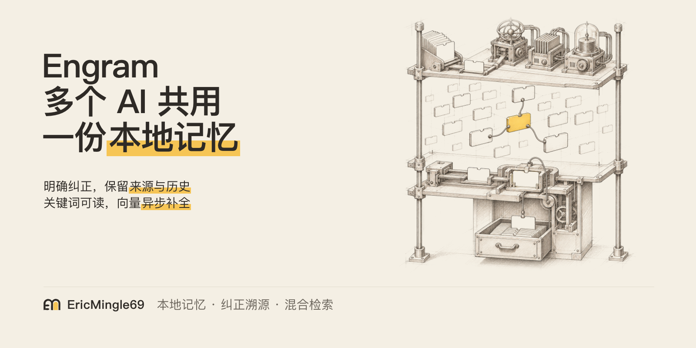

<picture>
  <source media="(prefers-color-scheme: dark)" srcset="readme-assets/cover-zh-dark.png">
  
</picture>

<p align="center"><a href="docs/architecture.md">架构</a> · <a href="docs/research-directions.md">研究方向</a> · <a href="CHANGELOG.md">版本记录</a> · <a href="CONTRIBUTING.md">贡献</a></p>
<p align="center">


</p>
<p align="center"><b>简体中文</b> · <a href="README.en.md">English</a></p>

# Engram · Agent 共用本地知识库

Engram 0.4.1 把长期知识保存在本机 SQLite 中，供不同 Agent 使用同一份事实源。写入方提供内容，分类与向量在后续补全；明确纠正形成可追溯关系，读取时区分当前适用内容与历史原文。

此前公开代码标为 0.1.0，没有正式版本标签。本包是对应当前核心实现的 0.4.0 公开源码，历史阶段按里程碑描述，不补造 0.2/0.3 发布。见 [版本变化](CHANGELOG.md)、[架构](docs/architecture.md)、[演化历史](docs/evolution.md) 和 [研究方向](docs/research-directions.md)。


## 主要功能

- 正文、项目绑定、修订、FTS 与 outbox 同事务提交。ID 与关键词提交后可读，向量和整理状态不作为可读门槛。
- `remember` 的可选 `corrections` 明确目标、整条/局部范围和来源。局部精确替换要求基线一致、片段唯一且范围不重叠。
- `recall(view="current")` 默认返回当前适用投影；`history` 与 `get` 保留历史原文。旧关键词、向量或关联边可沿明确纠正链解析到当前记录。
- 项目是可选的有限排序偏置，无注册要求；缺项目元数据仍可按正文检索。年龄或语义相似度不自动证明旧事实失效。
- 关键词、向量和 RRF 混合检索；语义故障明确退回关键词并返回降级信息。MLX 模型按需加载，共享本机嵌入接口串行推理。
- stdio MCP 与可选官方 SDK HTTP/SSE 接入；远程认证保留 Bearer、OAuth、PKCE、resource、Host/Origin 与本人授权边界。
- Claude Code 命令 Hook 可在相关上下文出现时进行有边界的关键词检索，按修订与纠正链变化再次提示，错误时放行。此包不安装个人 Hook 配置，也不宣称所有宿主对话均自动采用记忆。

## 快速开始

需要 Python 3.13+、uv。当前依赖使用 Apple MLX，支持 Apple Silicon macOS；关键词和写入路径不加载模型。

向量层还要求 Python 的 SQLite 启用扩展加载（`enable_load_extension`）；部分 macOS Python 发行版未启用此功能。下面使用 uv 管理的 Python；CI 会先检查这项能力，再运行全套合成测试。

```sh
uv sync --managed-python --all-groups --extra remote
uv run python examples/synthetic_corrections.py
uv run pytest
uv run ruff check .
```

示例仅创建临时合成传感器数据，演示“旧关键词 → 新值”，结束后删除临时库。`--offline` 的确定性向量用于工程测试，不能代表语义模型效果。

使用自己的库时设置 `ENGRAM_DATA_DIR`，保持数据目录在代码仓库外。以下内容也是合成示例：

```sh
export ENGRAM_DATA_DIR="$HOME/engram-data"
export ENGRAM_USAGE_TELEMETRY=0
uv run engram record create --title "Synthetic sensor" --body "synthetic-prism channel=amber"
uv run engram search "synthetic-prism" --mode keyword
uv run engram --human status
```

## 用法

```sh
uv run engram mcp
```

标准工具包含 `remember`、`recall`、`get`、`status` 和独立 `feedback`。Claude profile 共享同一合同；远程启动时须自行配置认证，不能将未认证接口直接放上公网。启动参数见 `uv run engram mcp --help`。

真实语义模型须由使用者另行准备在 `$ENGRAM_DATA_DIR/models/`，默认模型为 `Qwen3-Embedding-0.6B` 与 `Qwen3-1.7B-4bit`。模型缺失不会自动下载。`index drain` 补全，`index rebuild` 先暂存整批向量，再检查源内容一致性并替换旧索引。

## 设计与原理

本项目以 SQLite 作为事实源，正文与全文索引随事务提交；语义层稍后补全。混合检索使用倒数排名融合（RRF），将不同检索列表按排名合并。<sup>[[1]](#参考文献)</sup>

[架构与公开副本差异](docs/architecture.md) · [演化历史](docs/evolution.md)

<picture>
  <source media="(prefers-color-scheme: dark)" srcset="readme-assets/write-path-zh-dark.svg">
  
</picture>

## 局限

本包含自有核心源码、合成测试、示例与文档，不含实际记忆、日志、反馈、上下文、生产回执、个人配置、运维运行器或权重。受控内容维护、观测与固定证据模块是可复用源码，示例默认关闭观测及自动维护。源码自改进 `source_improvement` 依赖部署方另行提供的网关，本包不提供该流水线，默认不暴露该工具。

公开副本把设备验证器名称改为通用标识；运行观测时间表改为显式 `ENGRAM_RUN_SCHEDULES`，默认只有手动入口。认证与访问边界保留并强化：ASGI 前缀不能绕过 Bearer 或显式队列/超时限制；仅超时配置可正常释放请求；初始化图标声明与 SVG 响应一致；同 client/resource 的 spent refresh 重放会撤销活动 family，关联按哈希键保存且到期时间不超过旧令牌原始期限，不保存旧令牌明文。修复只针对本公共副本，原私有部署未改。详见 [架构与公开副本差异](docs/architecture.md)。

合成工程测试验证合同、反例和隔离行为；它们不能证明真实用户收益、长期检索精度或所有宿主采用率。研究论文成绩也不作为本库的体验成绩。贡献与持续版本维护见 [CONTRIBUTING.md](CONTRIBUTING.md)。

## 开发

贡献须使用完全虚构的数据；提交前运行完整合成测试与 lint，发布按文件清单检查版本和演化记录。见 [贡献规则](CONTRIBUTING.md)。

```sh
uv run pytest
uv run ruff check .
```

## 致谢

本项目使用 SQLite、sqlite-vec、Apple MLX 与 MCP Python SDK。封面插画由图像生成模型生成，经本项目处理。

## 参考文献

1. Cormack, G. V., Clarke, C. L. A., & Buettcher, S. (2009). Reciprocal rank fusion outperforms condorcet and individual rank learning methods. SIGIR, 758–759. https://doi.org/10.1145/1571941.1572114

## 相关研究

以下文献对应研究机制，不表示本项目按其实现或复现其结果；睡眠整理仍属研究方向。

- Packer et al. (2023). MemGPT: Towards LLMs as Operating Systems. arXiv. https://arxiv.org/abs/2310.08560 — 分层记忆与上下文管理。
- Xu et al. (2025). A-MEM: Agentic Memory for LLM Agents. arXiv. https://arxiv.org/abs/2502.12110 — 写入时的关联与记忆演化。
- Rasmussen et al. (2025). Zep: A Temporal Knowledge Graph Architecture for Agent Memory. arXiv. https://arxiv.org/abs/2501.13956 — 事实时效与版本溯源。
- Lin et al. (2025). Sleep-time Compute: Beyond Inference Scaling at Test-time. arXiv. https://arxiv.org/abs/2504.13171 — 规划中的空闲时记忆整理。

## 仓库结构

```text
src/engram/    核心源码
tests/        合成测试与发布检查
examples/     虚构数据示例
docs/         架构、演化与研究方向
readme-assets/ 封面素材
```

---

文档维护：**✦ EricMingle69** · [Ming-Sir-69](https://github.com/Ming-Sir-69)

[MIT License](LICENSE) · Copyright (c) 2026 Eric Mingle.

个人标识不扩大许可或授予本人身份，见 [个人标识说明](PERSONAL-NOTICE.md)。
